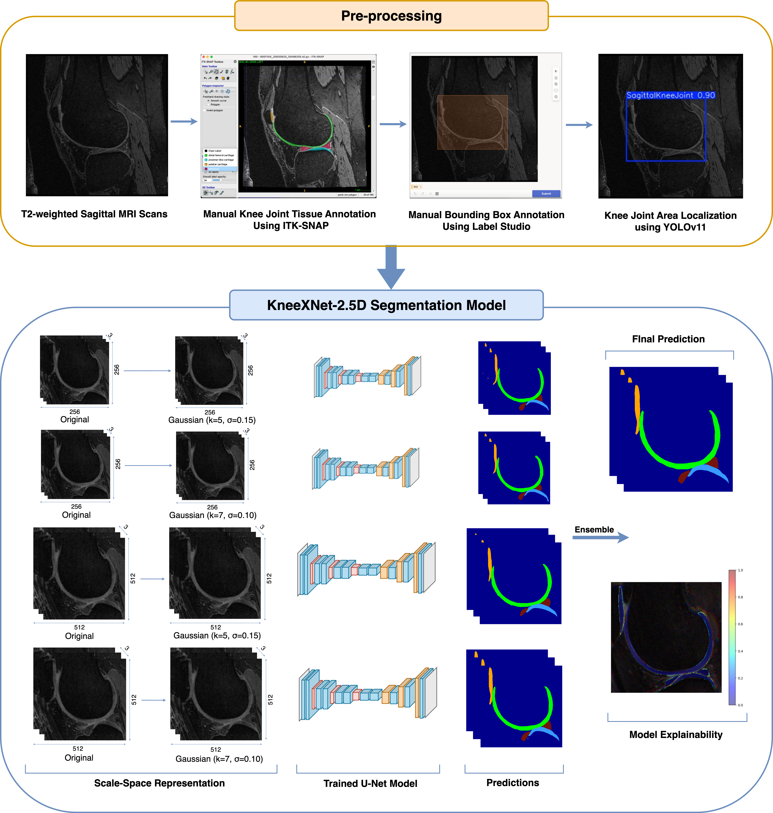

# Knee MRI Pipeline

[English](README.md) | [简体中文](README.zh-CN.md)

A Python pipeline for knee MRI cartilage and meniscus segmentation, with preprocessing, 2.5D/3D model training, independent evaluation, multi-resolution fusion, visualization, and interactive inference.

## Research collaboration

This project analyzes knee MRI data provided by Shanghai Longhua Hospital as part of a research collaboration. The analysis focuses on cartilage and meniscus segmentation.

## Implementation references

This repository's implementation draws on the open-source project [pitthexai/Knee_MRI_Segmentation_2.5D](https://github.com/pitthexai/Knee_MRI_Segmentation_2.5D) and the paper [KneeXNet-2.5D: a clinically-oriented and explainable deep learning framework for MRI-based knee cartilage and meniscus segmentation](https://www.nature.com/articles/s44401-026-00072-5), published in *npj Health Systems*. We thank the authors for sharing their research methods and code.

## Pipeline overview

The figure illustrates the reference KneeXNet-2.5D workflow: annotation and YOLOv11 localization, three-slice inputs at multiple resolutions and Gaussian scales, U-Net segmentation, ensemble prediction, and entropy-based visualization.

[](pipeline.png)

*Figure source: [pitthexai/Knee_MRI_Segmentation_2.5D — Figures/pipeline.png](https://github.com/pitthexai/Knee_MRI_Segmentation_2.5D/blob/main/Figures/pipeline.png). Click the figure to view it at full size.*

## Project structure

```text
Knee_MRI_pipeline/
+-- configs/                   # Experiment and ensemble configurations
+-- src/knee_mri/
|   +-- data/                  # Datasets, patient splits, localization, and crops
|   +-- models/                # 2.5D/3D models and weight loading
|   +-- engine/                # Training, evaluation, prediction, metrics, and fusion
|   +-- visualization/         # Segmentation panels, entropy maps, and learning curves
|   +-- common.py              # Configuration, IO, devices, and random seeds
|   +-- cli.py                 # Unified command-line entry point
+-- apps/                      # Interactive Streamlit application
+-- tests/                     # Configuration, data, and numerical tests
+-- data/                      # Raw data, processed data, and dataset splits
+-- outputs/                   # Models, metrics, probabilities, and visualizations
+-- pyproject.toml
+-- requirements.txt
```

The four core modules are [data](src/knee_mri/data/README.md), [models](src/knee_mri/models/README.md), [execution](src/knee_mri/engine/README.md), and [visualization](src/knee_mri/visualization/README.md). All Python functions have English docstrings available through editor tooltips or `help()`.

## Installation

Use Python 3.10 or 3.11 and run these commands from this directory:

```powershell
python -m venv .venv
.\.venv\Scripts\Activate.ps1
python -m pip install --upgrade pip
python -m pip install -e ".[volume,localization,app,dev]"
knee-mri --help
knee-mri check
```

For 2.5D training and evaluation only, install with `pip install -e .`. The `volume` extra enables 3D models, `localization` enables YOLO, and `app` enables the interactive application. `requirements.txt` installs all features. Choose a GPU build of PyTorch compatible with your CUDA environment.

## Data format

Pair 2.5D images and masks using this layout:

```text
data/processed/
+-- images/
|   +-- 9001104_20050825_10498205_slice_001.jpg
+-- masks/
    +-- 9001104_20050825_10498205/
        +-- 9001104_20050825_10498205_slice_001.npy
```

Images are grayscale JPEGs, and masks are two-dimensional integer arrays with matching dimensions. Three neighboring slices form a `[3,H,W]` input; missing neighbors repeat the central slice. Class definitions:

| ID | Class |
| --- | --- |
| 0 | Background |
| 1 | Distal femoral cartilage |
| 2 | Proximal tibial cartilage |
| 3 | Patellar cartilage |
| 4 | Meniscus |

3D data uses `data/processed/volumes/<study>/*.jpg` and `data/raw/annotations/<study>.nii.gz`. Slice order, mask orientation, and pixel locations must align. `mask_axis_order` controls the mask array axis permutation.

The patient ID is the study-name prefix before the first underscore. All visits from one patient remain in the same subset. Experiments at different resolutions share the same split.

## Training and evaluation

Set the data paths in the [experiment configurations](configs/README.md) first. Relative configuration paths resolve against `project_root`, which defaults to this project root. Additional command-line paths resolve against the current working directory.

```powershell
# Create patient-level splits
knee-mri split --config configs/noise_256_k5_s015.json

# Train and validate
knee-mri train --config configs/noise_256_k5_s015.json

# Evaluate the best model independently
knee-mri evaluate --config configs/noise_256_k5_s015.json

# Save segmentation, ground-truth, and entropy panels
knee-mri visualize --config configs/noise_256_k5_s015.json --exports outputs/noise_256_k5_s015/test --output outputs/noise_256_k5_s015/figures

# Save learning curves
knee-mri curves --log outputs/noise_256_k5_s015/training_log.csv --output outputs/noise_256_k5_s015/curves.png
```

Available configurations include a variable-size 2.5D baseline, four blur experiments at 256/512 resolution, and a 3D U-Net. The 3D workflow uses separate data directories and a volume split:

```powershell
knee-mri split --config configs/unet3d.json
knee-mri train --config configs/unet3d.json
knee-mri evaluate --config configs/unet3d.json
```

Training saves `best_model.pth`, `best.ckpt`, `last.ckpt`, CSV logs, and a JSON summary. Validation IoU selects the best model. Reusing an output directory overwrites existing training artifacts.

Evaluation exports `metrics.json`, a per-sample `manifest.json`, predicted labels, and softmax probabilities. Use `--checkpoint <path>` to select weights, `--subset val` for validation, and `--no-probs` to disable probability exports. Dice/IoU are macro-averaged over classes 1 through 4, then averaged across samples. A class absent from both prediction and target receives a score of one.

## Multi-resolution fusion

Train and evaluate each of the four noise configurations, then run:

```powershell
knee-mri fuse --config configs/noise_512_k5_s015.json --low outputs/noise_256_k5_s015/test outputs/noise_256_k7_s010/test --high outputs/noise_512_k5_s015/test outputs/noise_512_k7_s010/test --output outputs/fusion
knee-mri visualize --config configs/noise_512_k5_s015.json --exports outputs/fusion --output outputs/fusion/figures --mask-background
```

Probability maps are bilinearly resized to the target size, averaged within each resolution group, then averaged equally across groups. Inputs must be fixed-size 2.5D exports from the same patient split and crop version. Fusion validates sample IDs, order, and data directories.

## YOLO localization and cropping

```powershell
knee-mri yolo-prepare --images data/raw/images --labels data/raw/yolo_labels --output data/processed/yolo
knee-mri yolo-train --data data/processed/yolo/KneeMRI.yaml --checkpoint yolo11n.pt --epochs 50 --output outputs/yolo
knee-mri yolo-evaluate --data data/processed/yolo/KneeMRI.yaml --checkpoint ../Models/localizer.pt --output outputs/yolo_test
knee-mri crop --images data/raw/images --annotations data/raw/annotations --checkpoint ../Models/localizer.pt --output data/processed --slice-start 1 --mask-axes 0 1 2
```

YOLO uses matching txt labels with one `0 x_center y_center width height` detection per line and coordinates normalized to [0,1]. Negative samples require empty txt files. The highest-confidence box crops both image and mask. Use fresh output directories for dataset preparation and cropping.

Cropping reads masks with SimpleITK, so `--mask-axes` applies to its array order. The 3D dataset reads masks with nibabel; verify axis conventions separately for each reader.

## Unlabeled inference and application

Set model paths, resolution groups, and the optional localizer in [ensemble.json](configs/ensemble.json). Default weight paths point to `../Models`; you can also use `outputs/<experiment>/best_model.pth`. Set `localizer` to null for inputs that are already cropped and aligned.

```powershell
knee-mri predict --config configs/ensemble.json --input data/raw/volume.npy --output outputs/inference
streamlit run apps/streamlit_app.py
```

NPY input has shape `[N,H,W]`. A DICOM directory must contain single-frame grayscale slices from one series, sorted by InstanceNumber. Inference applies the central slice's bounding box to all three neighboring slices and reports an error if no ROI is detected.

The CLI saves `segmentation.npy` on the input image grid, per-slice probabilities, and ROI coordinate records. The application displays a selected slice and downloads its ROI segmentation. NPY outputs do not contain NIfTI affine or DICOM spatial metadata.

## Tests

```powershell
python -m unittest discover -s tests -v
```

See [tests/README.md](tests/README.md) for coverage. Tests requiring unavailable scientific dependencies are skipped. Full training and inference require imaging data and actual model weights. Git LFS pointers cannot be loaded as weights; use `knee-mri check` to inspect artifact status.
