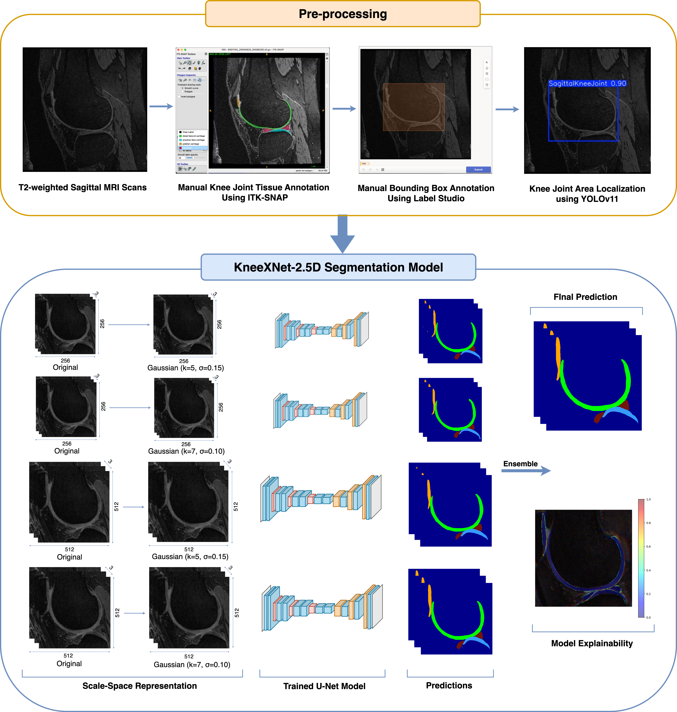

# Knee MRI Pipeline

[English](README.md) | [简体中文](README.zh-CN.md)

用于膝关节 MRI 软骨与半月板分割的 Python 项目，支持数据预处理、2.5D/3D 模型训练、独立测试、多分辨率融合、可视化和交互推理。

## 实现参考

本仓库的实现参考了 [pitthexai/Knee_MRI_Segmentation_2.5D](https://github.com/pitthexai/Knee_MRI_Segmentation_2.5D) 开源项目，以及发表于 *npj Health Systems* 的论文 [KneeXNet-2.5D: a clinically-oriented and explainable deep learning framework for MRI-based knee cartilage and meniscus segmentation](https://www.nature.com/articles/s44401-026-00072-5)。感谢作者公开研究方法与代码。

## 流程概览

下图展示参考方法 KneeXNet-2.5D 的整体流程：标注与 YOLOv11 定位、多分辨率和高斯尺度的三邻片输入、U-Net 分割、集成预测及基于熵的不确定性可视化。

[](pipeline.png)

*图片来源：[pitthexai/Knee_MRI_Segmentation_2.5D — Figures/pipeline.png](https://github.com/pitthexai/Knee_MRI_Segmentation_2.5D/blob/main/Figures/pipeline.png)。点击图片可查看完整尺寸。*

## 目录结构

```text
Knee_MRI_pipeline/
+-- configs/                   # Experiment and ensemble configurations
+-- src/knee_mri/
|   +-- data/                  # Datasets, patient splits, localization, and crops
|   +-- models/                # 2.5D/3D models and weight loading
|   +-- engine/                # Training, evaluation, prediction, metrics, and fusion
|   +-- visualization/         # Segmentation panels, entropy maps, and learning curves
|   +-- common.py              # Configuration, IO, devices, and random seeds
|   +-- cli.py                 # Unified command-line entry point
+-- apps/                      # Interactive Streamlit application
+-- tests/                     # Configuration, data, and numerical tests
+-- data/                      # Raw data, processed data, and dataset splits
+-- outputs/                   # Models, metrics, probabilities, and visualizations
+-- pyproject.toml
+-- requirements.txt
```

四个核心模块分别是[数据](src/knee_mri/data/README.zh-CN.md)、[模型](src/knee_mri/models/README.zh-CN.md)、[运行流程](src/knee_mri/engine/README.zh-CN.md)和[可视化](src/knee_mri/visualization/README.zh-CN.md)。所有 Python 函数均有英文文档字符串，可通过编辑器悬停或 `help()` 查看。

## 安装

使用 Python 3.10 或 3.11，在本目录执行：

```powershell
python -m venv .venv
.\.venv\Scripts\Activate.ps1
python -m pip install --upgrade pip
python -m pip install -e ".[volume,localization,app,dev]"
knee-mri --help
knee-mri check
```

只运行 2.5D 训练和测试可安装 `pip install -e .`。3D 需要 `volume`，YOLO 需要 `localization`，交互应用需要 `app`。`requirements.txt` 安装全部功能。GPU 版 PyTorch 应与 CUDA 环境匹配。

## 数据格式

2.5D 图像与标签按以下格式配对：

```text
data/processed/
+-- images/
|   +-- 9001104_20050825_10498205_slice_001.jpg
+-- masks/
    +-- 9001104_20050825_10498205/
        +-- 9001104_20050825_10498205_slice_001.npy
```

图像为灰度 JPEG，标签为相同尺寸的二维整数数组。三张相邻切片组成 `[3,H,W]` 输入，缺少邻片时复制中心切片。类别定义如下：

| ID | 类别 |
| --- | --- |
| 0 | 背景 |
| 1 | 股骨远端软骨 |
| 2 | 胫骨近端软骨 |
| 3 | 髌骨软骨 |
| 4 | 半月板 |

3D 数据使用 `data/processed/volumes/<study>/*.jpg` 和 `data/raw/annotations/<study>.nii.gz`。图像顺序、标签轴向和像素位置必须对齐；`mask_axis_order` 控制标签数组的轴排列。

患者 ID 为 study 名称第一个下划线前的部分。同一患者的不同访视归入同一集合，各分辨率实验共用相同划分。

## 训练与测试

先修改[实验配置](configs/README.zh-CN.md)中的数据路径。配置内相对路径按 `project_root` 解析，默认指向本项目根目录；命令行额外路径相对当前工作目录。

```powershell
# Create patient-level splits
knee-mri split --config configs/noise_256_k5_s015.json

# Train and validate
knee-mri train --config configs/noise_256_k5_s015.json

# Evaluate the best model independently
knee-mri evaluate --config configs/noise_256_k5_s015.json

# Save segmentation, ground-truth, and entropy panels
knee-mri visualize --config configs/noise_256_k5_s015.json --exports outputs/noise_256_k5_s015/test --output outputs/noise_256_k5_s015/figures

# Save learning curves
knee-mri curves --log outputs/noise_256_k5_s015/training_log.csv --output outputs/noise_256_k5_s015/curves.png
```

可选配置包括变尺寸 2.5D 基线、256/512 分辨率的四组模糊实验和 3D U-Net。3D 使用单独数据目录与划分：

```powershell
knee-mri split --config configs/unet3d.json
knee-mri train --config configs/unet3d.json
knee-mri evaluate --config configs/unet3d.json
```

训练输出 `best_model.pth`、`best.ckpt`、`last.ckpt`、CSV 日志和 JSON 摘要，按验证 IoU 选择最佳模型。重复使用输出目录会覆盖已有训练产物。

测试输出 `metrics.json`、逐样本 `manifest.json`、预测标签和 softmax 概率。`--checkpoint <path>` 指定权重，`--subset val` 选择验证集，`--no-probs` 关闭概率保存。Dice/IoU 对类别 1 至 4 宏平均，再按样本平均；预测和标签均为空的类别得分为 1。

## 多分辨率融合

分别训练并测试四组 noise 配置，再执行：

```powershell
knee-mri fuse --config configs/noise_512_k5_s015.json --low outputs/noise_256_k5_s015/test outputs/noise_256_k7_s010/test --high outputs/noise_512_k5_s015/test outputs/noise_512_k7_s010/test --output outputs/fusion
knee-mri visualize --config configs/noise_512_k5_s015.json --exports outputs/fusion --output outputs/fusion/figures --mask-background
```

概率按目标尺寸双线性对齐，先组内平均，再对分辨率组等权平均。输入须为相同患者划分与裁剪版本的固定尺寸 2.5D 测试导出；融合会校验样本 ID、顺序和数据目录。

## YOLO 定位与裁剪

```powershell
knee-mri yolo-prepare --images data/raw/images --labels data/raw/yolo_labels --output data/processed/yolo
knee-mri yolo-train --data data/processed/yolo/KneeMRI.yaml --checkpoint yolo11n.pt --epochs 50 --output outputs/yolo
knee-mri yolo-evaluate --data data/processed/yolo/KneeMRI.yaml --checkpoint ../Models/localizer.pt --output outputs/yolo_test
knee-mri crop --images data/raw/images --annotations data/raw/annotations --checkpoint ../Models/localizer.pt --output data/processed --slice-start 1 --mask-axes 0 1 2
```

YOLO 使用同名 txt 标签，每行 `0 x_center y_center width height`，坐标归一化到 [0,1]；负样本提供空 txt。定位选择最高置信度框，并对图像与标签同步裁剪。数据准备和裁剪应使用新的输出目录。

裁剪标签通过 SimpleITK 读取，`--mask-axes` 针对其数组轴序；3D 数据集通过 nibabel 读取，两种读取方式的轴定义需分别核对。

## 无标签推理与应用

配置 [ensemble.json](configs/ensemble.json) 的模型路径、分辨率分组和可选定位器。默认权重路径指向 `../Models`，也可使用 `outputs/<experiment>/best_model.pth`。预先裁剪且对齐的输入可将 `localizer` 设为 null。

```powershell
knee-mri predict --config configs/ensemble.json --input data/raw/volume.npy --output outputs/inference
streamlit run apps/streamlit_app.py
```

NPY 输入为 `[N,H,W]`；DICOM 目录须包含同一序列的单帧灰度切片，按 InstanceNumber 排序。推理使用中央切片的定位框裁剪三张邻片，无检测时报告错误。

CLI 输出图像数组尺寸的 `segmentation.npy`、各切片概率和 ROI 坐标记录。应用可显示所选切片并下载 ROI 分割。NPY 输出不包含 NIfTI affine 或 DICOM 空间元数据。

## 测试

```powershell
python -m unittest discover -s tests -v
```

测试范围见 [tests/README.md](tests/README.zh-CN.md)。科学计算依赖缺失时，对应测试显示 skipped。完整训练与推理需要可用影像数据和真实模型权重；Git LFS 指针不能作为权重加载，可通过 `knee-mri check` 检查文件状态。
